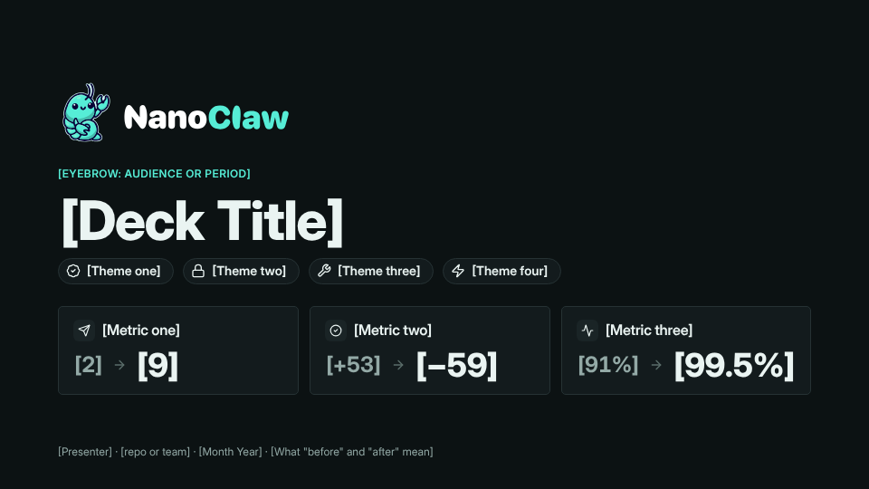
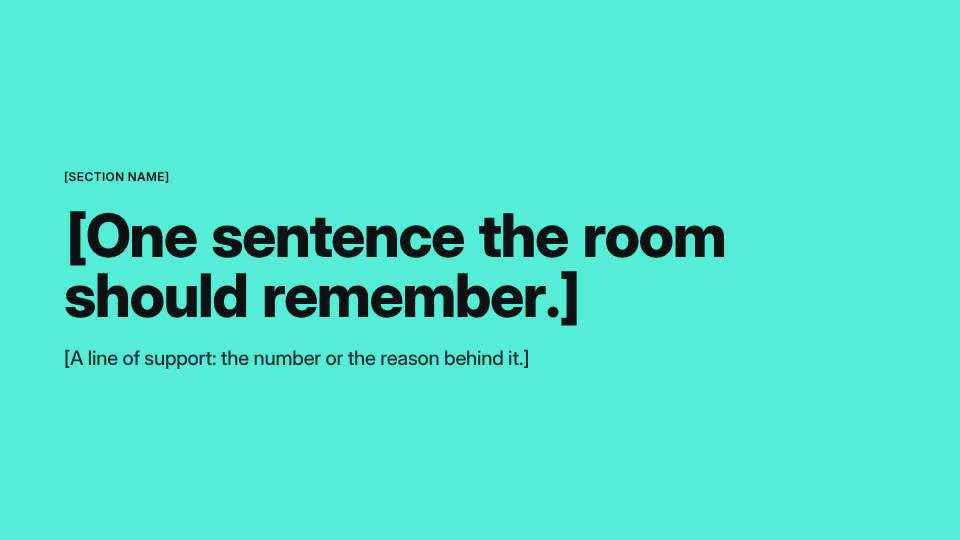
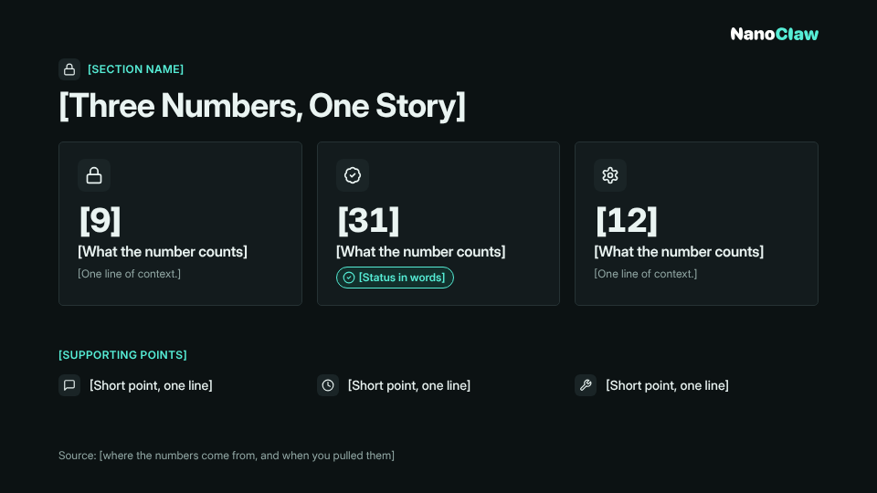
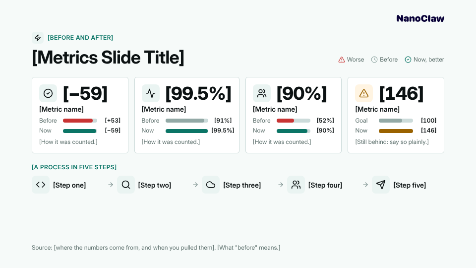
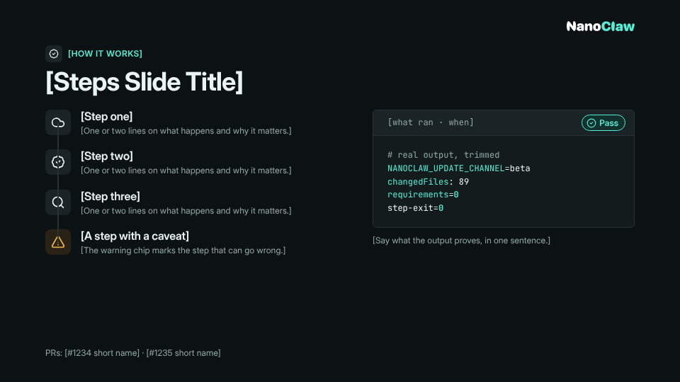
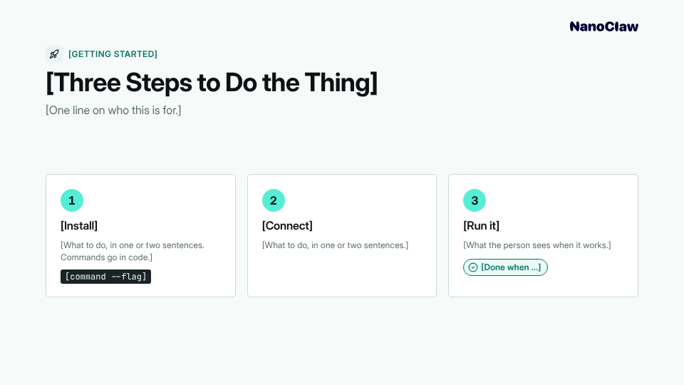
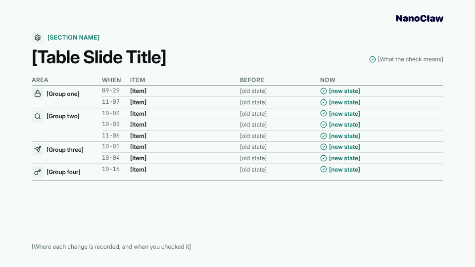
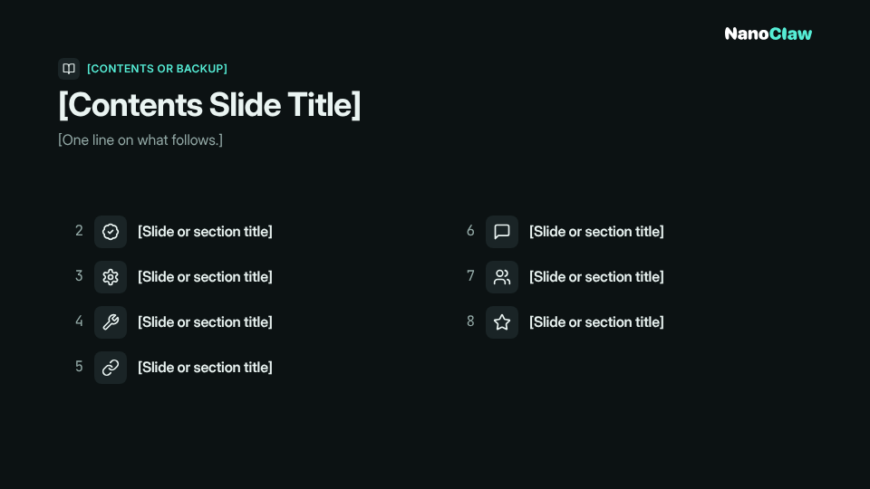
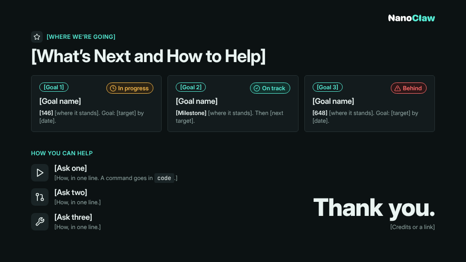

# NanoClaw slides

A slide kit for NanoClaw talks, demos and updates: three themes, nine layouts and one shared stylesheet, all built on the tokens in [`../tokens.css`](../tokens.css). The rules are in [BRAND.md › Slides](../BRAND.md#slides). Read those first.

| Cover | Statement | Stats |
|---|---|---|
|  |  |  |
| **Compare** | **Steps** | **Numbered** |
|  |  |  |
| **Table** | **Contents** | **Closing** |
|  |  |  |

Open [`preview.html`](preview.html) to see every layout at full size, with notes on when to use it.

## What's here

| Path | What it is |
|---|---|
| `deck.css` | The shared stylesheet: dark, `light` and `mint` themes, the slide type scale, components and motion. Plain CSS with no imports |
| `layouts/` | One slide per layout, as a single `<section>`, with placeholder text in [brackets] and speaker notes in `<aside>` |
| `nanoclaw-slides.potx` | A PowerPoint template with the same themes and layouts. It also opens in Keynote and Google Slides |
| `icons/` | The [Lucide](https://lucide.dev) icons the layouts use (ISC licence in `icons/LICENSE`). Find more at lucide.dev and paste the SVG in the same way |
| `preview.html`, `thumbs/` | Generated by `build.py`. Don't edit them by hand |
| `build.py` | Checks that `deck.css` matches `tokens.css`, then rebuilds the preview |

## Start a deck

### With Claude or another agent

Point the agent at this repository and say:

> Read BRAND.md first, including the Slides section. Build the deck from `slides/deck.css` and the layouts in `slides/layouts/`, using the files in `assets/` as they are. Replace every [bracketed] placeholder; never invent a number.

In Claude, the NanoClaw design system artifact is built from this folder. Pick it as your design system, or make it your default, and every new deck uses the NanoClaw look.

### As an HTML deck

Each layout is one `<section>` on a 1920 × 1080 canvas, so it works in [reveal.js](https://revealjs.com) or any page that scales a fixed canvas.

1. Load the fonts: Inter and JetBrains Mono from Google Fonts, or the `@font-face` rules at the end of `../tokens.css`.
2. Link `slides/deck.css`.
3. Copy the layouts you need. Keep a layout's classes and change only the words, numbers and icons.
4. Image paths in the layouts are relative to `slides/layouts/`. Fix them if your deck lives somewhere else.

For reveal.js, set `width: 1920, height: 1080, margin: 0` so slides aren't rescaled twice.

### In PowerPoint, Keynote or Google Slides

Open `nanoclaw-slides.potx`. It gives you a new, untitled deck with the three themes as slide masters and every layout as a sample slide. Duplicate the slides you need and delete the rest. Use **Inter** and **JetBrains Mono**: install them from `../assets/fonts/` or Google Fonts first, or PowerPoint will substitute another font.

The template keeps the colours, type, icons and placement. The arrival animations from the HTML layouts don't carry over, and icons are pictures: to change one, replace the picture with another from `icons/`.

## Change the kit

- **A colour:** change it in `tokens.css` and `tokens.json` first, then in `deck.css`, then run `python3 slides/build.py`. The script stops if a theme colour in `deck.css` doesn't match `tokens.css`.
- **A layout:** edit the file in `layouts/`, then run `python3 slides/build.py --png` to rebuild the preview and thumbnails. `--png` needs Chrome or Chromium, as `social/render.py` does; set `CHROME_BIN` if it isn't found.
- **The PowerPoint template:** edit `pptx/build-potx.js`, then run `node slides/pptx/build-potx.js` from the repository root (it needs `npm install pptxgenjs sharp`). It reads the icons from `icons/` and the logos from `../assets/`. Keep the master names (NanoClaw Cover, Statement, Dark, Light): decks made from the template refer to them.
